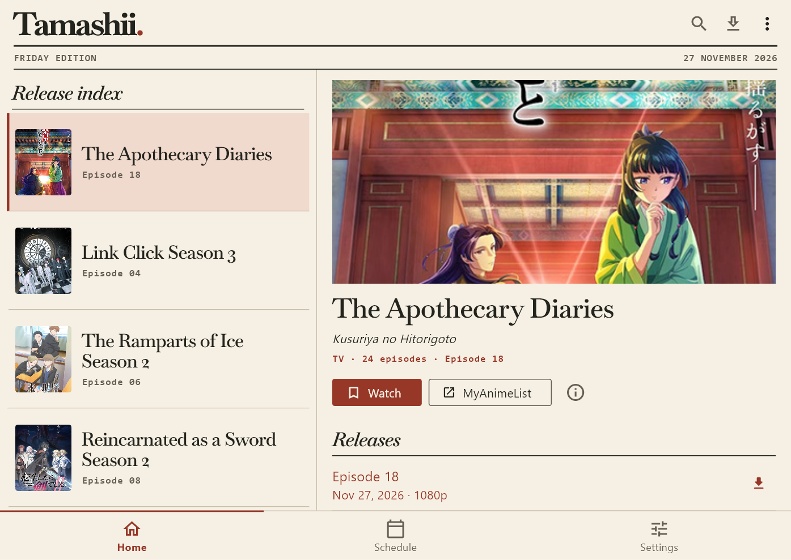

# Tamashii

Follow anime releases from SubsPlease, keep a weekly schedule of the shows you’re watching, and download episodes by torrent on Android and Windows.

**[Download Tamashii](https://github.com/Leapward-Koex/tamashii/releases)** · [Installation](#installation) · [Android widget](#android-widget) · [Development](#development)



*The wide-screen reader keeps the release list open beside the selected episode. Sample releases shown.*

## Installation

Choose a build from [GitHub Releases](https://github.com/Leapward-Koex/tamashii/releases). Each release page indicates whether it’s a prerelease.

| Platform | How to install |
| --- | --- |
| **Android 12 or newer** | Download and open the APK. If Android asks, allow your browser or file manager to install it. |
| **Windows x64** | Download the Windows ZIP, extract the entire folder, and open `tamashii.exe`. Keep the executable and its supporting files together. |

## Follow a series

1. **Find an episode on Home.** Search by title or browse the latest releases. Open one to read the synopsis and see other available episodes.
2. **Choose Watch to add the show to Schedule.** Your shows are grouped by release weekday. Turn on **Watching only** on Home to see releases from those series.
3. **Choose Download on an episode.** Each transfer starts when you select it and uses the highest resolution available for that release. In **Settings → Download Base Folder**, you can choose a parent folder for automatic series folders.
4. **Open Downloads to follow the transfer.** Check speed, peers, and time remaining, or pause and resume transfers individually or together. Completed episodes leave the queue and stay in their series folder, ready to open in your preferred player.

To plan a show before it appears in the feed, use **+** in Schedule, pick a weekday, and choose **Add by title**. You can link it to Tenrai later with **Edit catalog match**, or move it with **Change schedule day**. A matched show includes a link to MyAnimeList.

## Android widget

Add **Tamashii → Today on your watchlist** from your launcher’s widget picker. The compact widget shows which series are due today. Make it taller to see the release inbox.

When the feed confirms a new episode for today, tap **Download** beside it. If the series needs a folder, Tamashii opens its show page so you can choose one and start the download. If you still need to choose a base folder, the app opens **Settings**. The widget shows transfer progress and refreshes periodically while the app is closed.

## Downloads and storage

Folder choices and your watching list are independent. You can keep a show on Schedule without assigning a folder, or save episodes from a show you haven’t bookmarked. **Deleting a series folder in Settings also deletes the files inside it.**

<details>
<summary><strong>Troubleshooting downloads</strong></summary>

| What you see | What to check |
| --- | --- |
| **Waiting for network** on Android | Mobile data and metered networks are separate settings, both off by default. On metered cellular, enable both or switch to an allowed network. |
| A download won’t start | Choose a writable folder, grant folder access when prompted, and check the drive’s free space. |
| Transfers stop in the background | On Android, check notification permissions and battery optimisation for Tamashii. On Windows, keep the app running until the transfer finishes. |

</details>

## Sources and privacy

Tamashii works without an account. Your watching list, folder choices, and download markers are stored on your device. Release listings and torrent magnets come from [SubsPlease](https://subsplease.org). Catalog matches use [Tenrai](https://tenrai.org).

Torrent transfers can expose your IP address to peers and trackers. Download only material you’re entitled to access.

## Development

Use the Flutter version pinned in [`.fvmrc`](.fvmrc). From the repository root, enable Git LFS for the bundled torrent binaries, install dependencies, and run the tests.

```sh
git lfs install
git config --local core.hooksPath .githooks
flutter pub get
flutter test
```

For a development run, use the small Big Buck Bunny test torrent.

```sh
flutter run --dart-define=TAMASHII_USE_TEST_TORRENT=true
```

If you use FVM, run the Flutter commands with `fvm flutter`. The pre-commit hook formats staged Dart files and runs `flutter analyze --no-pub`. It stops if a staged Dart file also contains unstaged edits.

[Report a bug or suggest a feature](https://github.com/Leapward-Koex/tamashii/issues). For bugs, include your platform, app version, what you expected, and what happened.
